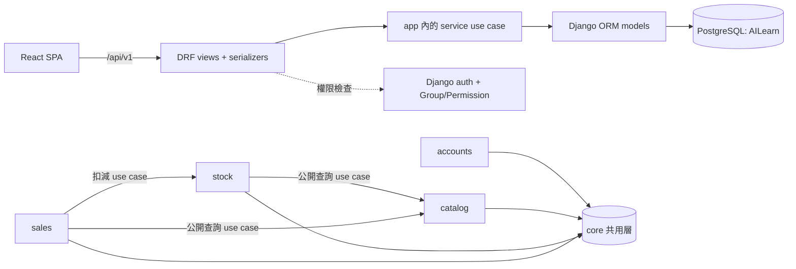
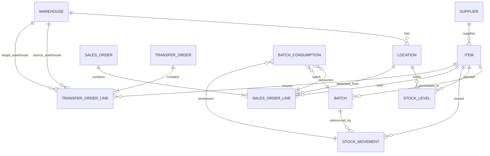

# Architecture Spine — 庫存管理系統

## Design Paradigm

**分層單體（Layered Monolith）**：Django 的 MVT 骨架，外加一層明確的 **service 層** 作為領域寫入的唯一邊界。四個 Django app 對應四個 epic；app 之間不直接依賴，跨 app 的讀取走被依賴 app 的公開查詢 use case，跨 app 的寫入走對方的 service use case。



方向規則：`sales → stock → catalog` 單向；`stock` 不得呼叫 `sales`；任何 app 不得寫入其他 app 的 model（AD-2、AD-3、AD-24）。

## Invariants & Rules

### AD-1 — 四個 app 對應四個 epic [ADOPTED]

- **Binds:** all
- **Prevents:** 各 epic 各自發明模組邊界，產出互不相容的結構
- **Rule:** app 只能是 `accounts`（E1）、`catalog`（E2）、`stock`（E3）、`sales`（E4）；共用程式碼放 `core`，不得另立第五個領域 app。

### AD-2 — 依賴方向單向，跨 app 讀取有白名單

- **Binds:** all
- **Prevents:** 循環依賴、跨邊界的隱式耦合
- **Rule:** 跨 app 的**讀取**只允許經對方的公開查詢 use case（`catalog`：商品／批次查詢；`stock`：各倉可用量查詢），不得直接 import 他方 model 做篩選或彙總；**寫入**他人資料一律呼叫對方 service use case；反向呼叫（stock→sales）一律禁止。

### AD-3 — 庫存寫入只經過 domain service use case

- **Binds:** R6, R11, R12, R13, R14, R16, R19
- **Prevents:** 交易邊界與守衛規則散落在 view 或 serializer，導致部分寫入繞過檢查
- **Rule:** 任何改變庫存數量或寫入異動／銷貨紀錄的動作，只能在 `services.py` 的 use case 函式內完成，並以 `transaction.atomic()` 包住；view 與 serializer 不得直接 `save()`／`update()`／`delete()` 這些 model。

### AD-4 — 守衛規則集合

- **Binds:** R11, R12, R14, R16
- **Prevents:** 重複扣減、跨倉搬貨無單據、庫存變負
- **Rule:** 銷售用途的庫存扣減只能經銷貨 use case；**領用用途只有「客戶寄貨」與「臨時出貨」兩個值，不存在「銷貨」用途，且領用一律不計毛利**；任何跨倉庫存變動必須帶有調貨單；庫存數量不得為負，超領時整筆回滾。

### AD-5 — 權限以 Django auth + Group/Permission 落地 [ADOPTED]

- **Binds:** R1, R2, R20
- **Prevents:** 出現第二套權限系統，或只靠前端隱藏按鈕
- **Rule:** PRD FR-2 的權限矩陣展開為 permission codename，由 `core/permissions.py` 集中宣告；每個 view 宣告所需權限，越權請求在 view 層被拒絕（403）；會計角色的 view 一律唯讀；讀寫權限分離（唯讀角色不得取得任何寫入 permission）。

### AD-6 — 認證採 session + CSRF，密碼單向雜湊 [ADOPTED]

- **Binds:** R1
- **Prevents:** 第二套 token 生命週期、跨來源 cookie 與 CSRF 設定分歧、明文密碼
- **Rule:** 前端以 Vite dev proxy 將 `/api` 轉送 Django（同源）；Django session cookie + CSRF token 為唯一認證機制；正式環境由 Django 直接提供前端靜態檔以維持同源；使用者密碼以 Django 預設雜湊器（PBKDF2 或 Argon2）儲存，禁用可降級的舊雜湊演算法，程式碼中不得出現明文密碼或自建密碼欄位。

### AD-7 — API 契約固定 [ADOPTED]

- **Binds:** all
- **Prevents:** 前後端各自發明路徑、欄位與錯誤形狀
- **Rule:** 路徑前綴 `/api/v1/`；欄位沿用 DRF 預設 snake_case，不加 camelCase 轉換層；錯誤一律回應 `{"code": ..., "detail": ..., "field_errors": {...}}`；分頁與過濾沿用 DRF 慣例；唯讀的報價試算端點回傳 `cost_status` 欄位（AD-26）。

### AD-8 — 業務編號與內部主鍵分離

- **Binds:** R4, R9
- **Prevents:** 用顯示編號當外鍵、編號重複或事後改號
- **Rule:** 內部主鍵為整數（必要時 bigint），不對外語意化；商品編號 `INV-` + 6 碼、採購批次流水號 `PO-YYYYMMDD-序號`，皆由 DB sequence 產生、建立後不可修改，序號在同一日內全域遞增。

### AD-9 — 數值型別與捨入

- **Binds:** R17, R18
- **Prevents:** 浮點誤差、前後端各自捨入造成對帳不平、把「缺成本」誤記為 0
- **Rule:** 數量為整數；單價、總價、銷貨金額為 `Decimal(12,2)`；所有捨入為 `ROUND_HALF_UP`；API 傳輸金額固定小數兩位；**成本未設定時回傳 `null` 與 `cost_status="unset"`，不得以 0 代替**（AD-26）。

### AD-10 — 時間一律 UTC 儲存 [ADOPTED]

- **Binds:** R6, R19
- **Prevents:** 跨時區計算與顯示不一致
- **Rule:** 資料庫與 API 一律 UTC（ISO 8601，含時區）；顯示層轉 `Asia/Taipei`；業務日期（如採購日期、帳務日）另存為 date，不從 timestamp 推導。

### AD-11 — 成本基準 FIFO，批次原始資料不可被彙總值取代 [ADOPTED]

- **Binds:** R18
- **Prevents:** 預存彙總成本後無法改基準、毛利與批次對不上
- **Rule:** 成本 = 依序消耗的批次採購單價 × 數量；銷貨未指定批次時由系統依 FIFO 自動挑批次；不得在批次或商品表保存彙總成本欄位；**批次一經建立，其單價、數量、採購日期不得修改**（更正以新批次表達）。

### AD-12 — 交易類資料僅追加

- **Binds:** R6, R9, R19
- **Prevents:** 稽核資料被改寫或刪除
- **Rule:** 庫存異動、銷貨紀錄、**採購批次**不得 `update()`／`delete()`（於 manager 層封鎖，只提供 append 與查詢）；取消銷貨以反向沖銷紀錄表達；設定類資料（供應商、商品）以 `is_active` 軟刪除，**交易類資料不得使用 `is_active` 軟刪除**。

### AD-13 — schema 變更唯一途徑為 Django migrations

- **Binds:** all
- **Prevents:** 手改 schema 造成環境漂移
- **Rule:** 任何 schema 變更以 migration 提交，app 之間的 FK 只指向被依賴 app 的公開模型；migration 必須可從空庫一次跑完；migration 中不得寫入憑證或真實資料。

### AD-14 — 測試與資料紀律

- **Binds:** R5, R6, R8, R11, R12, R13, R14, R16
- **Prevents:** 帳面與異動紀錄不一致卻被當成完成
- **Rule:** 使用 pytest + pytest-django + factory_boy；測試使用獨立資料庫；每個改變庫存數量的 use case 都要有測試；必須存在一組測試驗證帳面等式 `入庫 − 領用 − 調出 + 調入 − 銷貨 = 0` 與跨倉異動必對應調貨單；固定 seed 資料集可重跑；**測試不得連線 `AILearn`**。

### AD-15 — 資料庫與憑證

- **Binds:** all
- **Prevents:** 憑證外洩、與其他專案共用資料庫
- **Rule:** 單一 PostgreSQL 實例上的單一 schema（本專案專用 `AILearn`）；連線憑證由 `PGPASSFILE` 指向的 `pgpass.conf` 提供，密碼不得出現在程式碼、文件、migration 與版控中（含 `AGENTS.md` 等說明文件）。

### AD-16 — 前端建置與供應方式 [ADOPTED]

- **Binds:** all
- **Prevents:** 兩套靜態資源服務並存、部署時前端與後端版本不一致
- **Rule:** 前端為 Vite + React + TypeScript；開發以 Vite dev server + proxy 呼叫 Django；正式以 `npm run build` 產出靜態檔，由 Django（WhiteNoise）同源供應；前端功能目錄 `features/` 對應四個 app；依賴版本以 `package-lock.json` 鎖定。

### AD-17 — 錯誤處理集中於單一 exception handler

- **Binds:** all
- **Prevents:** 前端為每種錯誤形狀各自解析
- **Rule:** 領域例外（驗證失敗、越權、庫存不足、狀態衝突）由 `core/exceptions.py` 定義，在單一 DRF exception handler 轉為 AD-7 的錯誤包絡；業務錯誤不得以 500 回應；錯誤 `code` 為固定的機器可讀字串（如 `stock.insufficient`、`auth.locked`、`sales.duplicate_item`）。

### AD-18 — 日誌與稽詢取用

- **Binds:** R3, R6, R19
- **Prevents:** 事後無法追查誰在何時做了什麼
- **Rule:** 每筆庫存異動與銷貨紀錄永久保存操作人員、時間、數量、用途、批次；應用層日誌至少記錄 request id、actor id 與 use case 名稱，不記錄密碼或完整憑證。

### AD-19 — 登入失敗計數與帳號鎖定

- **Binds:** R1
- **Prevents:** 兩種登入實作對「鎖定多久、錯誤訊息怎麼寫」各自發明
- **Rule:** 連續登入失敗計數存於 DB（不以記憶體或快取），同一帳號第 5 次失敗即鎖定 15 分鐘（以 UTC 計算），鎖定期間即使密碼正確也拒絕登入；**帳號不存在與密碼錯誤回應同一訊息「帳號或密碼錯誤」與同一碼 `auth.invalid_credentials`**（不透露帳號是否存在），已鎖定回應 `auth.locked` 並顯示剩餘鎖定時間。

### AD-20 — 唯一性約束落在資料庫

- **Binds:** R7, R10
- **Prevents:** 同時寫入時產生重複統編、倉庫編碼或位置代碼
- **Rule:** 供應商統編、倉庫編碼、同一倉庫內的位置代碼、商品編號、採購批次流水號皆以 DB UNIQUE constraint 落實；違反時回應 409 並在 `field_errors` 指回既有資料，不以應用層先查後插作為唯一防線。

### AD-21 — 建議調貨來源的決定演算法

- **Binds:** R15
- **Prevents:** 銷售端各自挑來源倉，導致建議與實際扣減不一致
- **Rule:** 建議調貨來源 = 可用量 > 0 且能覆蓋需求量的倉庫中，可用量最大者；可用量相同時以倉庫編碼升序決定；無任何倉庫可覆蓋時回應明確的「無庫存」狀態碼，不回應任何建議。建議僅為唯讀輸出，實際調貨由 stock 端執行（AD-30）。

### AD-22 — 銷貨單狀態機

- **Binds:** R16, R19
- **Prevents:** 草稿與已扣庫存單無法區分、沖銷與送出順序混亂
- **Rule:** 銷貨單狀態只有 `draft`（不扣庫存、可自由改行）與 `submitted`（已扣庫存、內容不可再改）；`draft → submitted` 為唯一前進路徑；取消銷貨不回到 `draft`，而是 append 一筆反向沖銷的 `submitted` 單與對應的庫存異動；同一張單內同一商品不得重複列示。

### AD-23 — 設定分層與環境分離

- **Binds:** all
- **Prevents:** 正式環境沿用 `DEBUG=True` 或共用開發資料庫
- **Rule:** 設定分為 base／dev／test／prod 四層；正式環境 `DEBUG=False`、`SECRET_KEY` 與允許主機由環境變數注入（不得有預設值落版控）；正式與開發使用不同的資料庫設定（開發 `AILearn`、測試由 pytest 建立、正式需明確指定）；啟動時若正式設定缺少必要環境變數應直接失敗而非退回預設。

### AD-24 — 架構守門納入建置

- **Binds:** all
- **Prevents:** 規則只存在文件中，實際程式碼逐步偏離
- **Rule:** 以工具把規則變成可執行的檢查並納入建置流程：依賴方向以 import-linter 契約（`accounts`、`catalog`、`stock`、`sales` 僅可依賴 `core` 與下層）阻斷跨層 import；view 不得直接寫 model 以 django-architectural-rules 或同等自訂檢查阻斷；`makemigrations --check` 與 migration 完整性檢查納入建置；違規即建置失敗。**落地時程：E2 起**（E1 因使用者決定的範圍限制未含，期間規則僅存在於文件、靠 code review 維持）。

### AD-25 — 查詢效能基準與索引策略

- **Binds:** R5, R8, R15
- **Prevents:** 效能基準被當成 v2 事項，或靠事後加索引救火
- **Rule:** 以 1,000 筆商品、10,000 筆庫存異動的固定資料集，清單與明細查詢 2 秒內回應（不含報表彙總與匯出）為硬基準，並以自動化測試守住；必要索引至少涵蓋 `STOCK_LEVEL(item, location)`、`STOCK_MOVEMENT(item, occurred_at)`、`ITEM(name)` 與 `BATCH(item, received_at)`；索引新增必須連同其查詢用途寫在 migration 說明中。

### AD-26 — 報價試算與成本狀態

- **Binds:** R16, R18
- **Prevents:** 前端自行組裝毛利公式、成本缺漏時被當成 0
- **Rule:** 提供唯讀的報價試算端點，回傳原價合計、折後金額、逐行成本與毛利彙總；成本來源為批次 FIFO（AD-11），後端為唯一計算者，前端不得自行計算；商品無任何入庫成本紀錄時，該行成本與毛利回傳 `null` 並標記 `cost_status="unset"`，不得顯示 0。

### AD-27 — 交付優先序

- **Binds:** all
- **Prevents:** 評分標準、PRD 與 spine 互相衝突時無仲裁依據
- **Rule:** 衝突時依序以「課業評分標準 → PRD → addendum → 本 spine → 實作慣例」為準；本 spine 與 PRD 衝突時，視為 spine 需更新或交由使用者裁決，不擅自採用 spine。

### AD-28 — 事實唯一 home

- **Binds:** R6, R16, R19
- **Prevents:** 同一筆銷貨被寫成三份事實（銷貨行／銷貨紀錄／庫存異動），沖銷時只補其中一處
- **Rule:** 銷貨事實的 home 是 `SALES_ORDER` 與 `SALES_ORDER_LINE`；庫存事實的 home 是 `STOCK_MOVEMENT`；兩者以 sales 端擁有的連結表 `BATCH_CONSUMPTION`（銷貨行 × 批次 × 對應庫存異動）append-only 關聯，不在 stock 端建立指向 sales 的 FK；一次銷貨的寫入（銷貨行、連結表、庫存異動、庫存現況更新）必須在同一 `transaction.atomic()` 內完成，沖銷則在另一個交易內 append 三處的對應紀錄。

### AD-29 — 庫存現況的唯一真相

- **Binds:** R5, R6, R8, R11, R12, R13, R14
- **Prevents:** 同一商品同時存在「現況欄位」與「異動彙總」兩個數字
- **Rule:** `STOCK_LEVEL`（商品 × 位置）是庫存數量的唯一真相，由異動 use case 在同一交易內更新；不得以「查異動彙總」的方式另算一個數字對外提供；跨 app 讀取可用量只經 stock 的公開查詢 use case（AD-2）。

### AD-30 — 銷貨的位置、扣減與併發

- **Binds:** R15, R16
- **Prevents:** 銷貨行沒有位置、扣減倉庫與顯示倉庫不一致、併發下超賣
- **Rule:** 銷貨行必填**庫存位置**（商品 × 位置），不可只指定商品；扣減 use case 回傳實際扣減的位置與數量，若位置庫存不足則整筆拒絕並回報各倉可用量；可用量檢查與扣減必須在同一交易內完成，並對該 `STOCK_LEVEL` 列加鎖（`SELECT … FOR UPDATE`）後重驗可用量。

### AD-31 — 批次消耗明細與 FIFO 排序鍵

- **Binds:** R9, R18
- **Prevents:** FIFO 排序鍵不一致（建立時間 vs 入庫時間）導致成本與毛利不一致、消耗明細無法稽核
- **Rule:** FIFO 排序鍵固定為**入庫異動的發生時間**（不是批次建立時間），同秒再以批次主鍵升序打破平手；每筆銷貨行的批次消耗明細（含批次、數量、單價、成本）必須持久化（AD-28 的連結表），使毛利可逐筆回溯到批次。

### AD-32 — Actor 契約

- **Binds:** R3
- **Prevents:** 不同 use case 用不同方式取得操作人員（thread-local、隱式全域），造成無法在交易中追溯
- **Rule:** use case 的 actor 為**顯式參數**（不得依賴 thread-local 或隱式全域），型別為帳號代號字串；紀錄上同時保存當下的帳號代號快照，帳號改名或停用不影響既有紀錄；跨 app 呼叫 use case 時 actor 必須沿用呼叫端傳入的值，不得重新推導。

### AD-33 — 介面語系與格式化 [ADOPTED]

- **Binds:** all
- **Prevents:** 後端回傳使用者可見文字、字串硬寫在元件內、金額與日期格式隨實作者而異
- **Rule:** 介面 v1 只出繁體中文（zh-TW，預設）；en-US 的 catalog 條目與語系切換骨架保留但**不啟用翻譯**（2026-10-21 使用者決定「英文介面先停用」），之後補翻譯只需逐條加入 catalog、不改元件。所有使用者可見字串（介面文字、錯誤訊息、欄位標籤、空狀態文案）一律來自 message catalog，元件內不得硬寫字；後端回應使用者可見的錯誤一律以機器可讀 `code` 傳遞（AD-7、AD-17），文案由前端 catalog 本地化；日期、數字與金額格式一律以 `Intl` 依當前語系呈現（金額小數兩位、數量為整數、數字使用等寬數字），後端不輸出已格式化的顯示字串；資料內容本身（商品名稱、供應商名稱、備註）不隨介面語系翻譯。

### AD-34 — 調貨單的歸屬與建立者 [ADOPTED]

- **Binds:** R14, R15
- **Prevents:** 跨倉異動找不到對應單據、調貨單在多個 app 各建一份、權限在前後端各自實作
- **Rule:** 調貨單（與其明細）由 **stock app 擁有**（E3）；只有**銷售**角色可建立，倉管唯讀可見（PRD FR-2，2026-10-21 裁決）；任何跨倉庫存異動必須引用一張已存在的調貨單（AD-4），移出與移入兩筆異動都必須帶該調貨單識別碼；調貨單不可刪除，只能作廢並留下紀錄。

## Consistency Conventions

| Concern | Convention |
| --- | --- |
| Naming（實體、檔案、介面） | Python/Django 一律 snake_case（模組、函式、欄位），model 類別 PascalCase，表名沿用 `app_label_model`；API 資源路徑 kebab-case；前端元件檔 PascalCase、變數 camelCase |
| Data & formats（id、日期、錯誤、envelope） | 業務編號以字串傳輸、內部主鍵以整數傳輸；日期時間 ISO 8601 UTC，日期為 `YYYY-MM-DD`；金額固定小數兩位；錯誤包絡見 AD-7；缺值以 `null` 表達並附狀態欄位（AD-26） |
| State & cross-cutting（變更、錯誤、log、設定、auth） | 寫入一律經 service（AD-3）；交易以 `transaction.atomic()` 為單元；設定以環境變數注入（`DJANGO_SETTINGS_MODULE`、`PGPASSFILE`、`SECRET_KEY`），不得硬編碼（AD-23）；時區顯示 `Asia/Taipei`、儲存 UTC（AD-10）；認證見 AD-6、權限見 AD-5 |
| 查詢與排序 | 名稱查詢一律「完全相同優先，其餘部分符合依建立時間升序」；清單一律以明確的排序鍵排序，不得依賴資料庫預設順序；分頁上限固定並在 API 契約中明訂 |

## Stack

| Name | Version |
| --- | --- |
| Python | 3.14.7 |
| Django | 6.1.2 |
| djangorestframework | 3.18.3 |
| psycopg[binary] | 3.3.6 |
| PostgreSQL | 18.6 |
| Node.js | 22.18.0 |
| Vite | 8.3.4 |
| @vitejs/plugin-react | 6.1.2 |
| React / React-DOM | 19.3.1 |
| @tanstack/react-query | 5.104.5 |
| tailwindcss / @tailwindcss/vite | 4.3.3 |
| lucide-react | 1.61.0 |
| TypeScript | 5.9.3 |
| pytest | 9.1.1 |
| pytest-django | 4.14.0 |
| factory_boy | 3.3.3 |
| WhiteNoise | 6.12.0 |
| waitress | 3.0.2 |

> 部署伺服器選 `waitress`（跨平台 WSGI）而非 `gunicorn`（僅 UNIX/WSL，不支援原生 Windows）。版本以 lockfile（`requirements.txt` / `package-lock.json`）鎖定並定期更新。

## Structural Seed

### 原始碼樹

```text
backend/
  config/          # settings（base/dev/test/prod）、urls、wsgi
  core/            # 共用：base models、permissions、exceptions、errors、money、time、pagination
  accounts/        # E1 登入、角色權限、帳號生命週期、actor 快照、守衛規則基線
  catalog/         # E2 商品、供應商、倉庫與位置、採購批次
  stock/           # E3 庫存現況、異動、入庫/領用/移轉/調貨、水位與待補貨清單
  sales/           # E4 銷貨單、批次消耗連結表、折扣、毛利、銷貨紀錄
  tests/           # pytest 設定、factories、seed、帳面等式與效能測試
frontend/
  src/features/    # accounts / catalog / stock / sales
  vite.config.ts   # dev proxy → /api
```

### 核心實體 ERD



`STOCK_LEVEL`（商品 × 位置）是庫存數量的唯一真相（AD-29）；`STOCK_MOVEMENT` 是僅追加的異動明細；`BATCH_CONSUMPTION` 是 sales 端擁有的跨 app 連結表（AD-28）；`TRANSFER_ORDER` 屬於 stock app，是跨倉異動必須引用的單據（AD-34）。

### 環境

| 環境 | 後端 | 前端 | 資料庫 | 憑證 |
| --- | --- | --- | --- | --- |
| 開發 | `manage.py runserver`（:8000） | Vite dev server（:5173），`/api` 走 proxy | 本機 `AILearn` | `pgpass.conf`（`PGPASSFILE`） |
| 測試 | pytest（獨立測試資料庫） | 不需啟動 | pytest 建立之獨立 DB | 測試設定覆寫，禁連 `AILearn`（AD-14） |
| 正式（本機） | waitress + WhiteNoise | `npm run build` 產物 | 正式設定另指定之資料庫 | 環境變數注入（AD-23） |

## Capability → Architecture Map

| Capability / Area | Lives in | Governed by |
| --- | --- | --- |
| R1 登入與錯誤處理 | accounts | AD-1, AD-5, AD-6, AD-19, AD-17 |
| R2 角色權限 | accounts + core/permissions | AD-5, AD-1, AD-24 |
| R3 操作人員紀錄 | accounts（actor）+ 各 app 寫入 | AD-3, AD-12, AD-18, AD-32 |
| R4 商品主檔 | catalog | AD-1, AD-2, AD-8, AD-20 |
| R5 商品查詢與定位 | stock（庫存現況）+ catalog（索引） | AD-2, AD-3, AD-14, AD-25, AD-29 |
| R6 庫存異動紀錄 | stock | AD-3, AD-12, AD-18, AD-28, AD-29 |
| R7 供應商資料 | catalog | AD-1, AD-20 |
| R8 補貨水位 | stock（規則）＋ catalog（欄位） | AD-2, AD-3, AD-25 |
| R9 採購批次 | catalog | AD-1, AD-8, AD-11, AD-12, AD-31 |
| R10 倉庫與位置 | catalog | AD-1, AD-8, AD-20 |
| R11 入庫 | stock | AD-3, AD-4, AD-11, AD-14, AD-29, AD-31 |
| R12 領用 | stock | AD-3, AD-4, AD-14, AD-29 |
| R13 同倉移轉 | stock | AD-3, AD-4, AD-29 |
| R14 跨倉調貨 | stock | AD-3, AD-4, AD-14, AD-21, AD-29 |
| R15 可售狀態查詢 | sales（檢視）＋ stock（各倉可用量） | AD-2, AD-21, AD-25, AD-30 |
| R16 組合銷貨單 | sales | AD-3, AD-4, AD-9, AD-14, AD-22, AD-26, AD-28, AD-30, AD-31 |
| R17 折扣 | sales | AD-7, AD-9, AD-26 |
| R18 毛利與建議售價 | sales（計算）＋ catalog（批次成本） | AD-9, AD-11, AD-26, AD-31 |
| R19 銷貨紀錄 | sales | AD-3, AD-12, AD-18, AD-22, AD-28 |
| R20 帳號生命週期 | accounts | AD-5, AD-6, AD-19 |

## Open Questions

| 問題 | 目前的暫定處理 | 等待者 |
| --- | --- | --- |
| 「客戶寄貨」是否視為已銷貨並計毛利（PRD §8.1） | 視為非銷售出貨，不計毛利（AD-4） | E4 動工前確認 |
| 折扣是否可疊加（PRD §8.1） | 一張單一階百分比（AD-7、AD-9） | E4 動工前確認 |
| 倉庫編碼與位置代碼的實際格式 | 暫用 `A1`、`A-03`，需對齊公司既有規則（AD-20 只保唯一性） | E2 動工前確認 |
| 部門與角色是否一對一 | 假設四種職能各對應一個部門 | E1 動工前確認 |
| 退貨流程 | v1 只支援取消銷貨（反向沖銷），退貨不做（AD-22） | v2 |
| 會計角色的報表深度 | v1 只提供明細查核 | v2 |
| 商品是否需多供應商欄位 | v1 單一供應商 | v2 |
| 前端資料層與快取方案 | **已決：TanStack React Query 5.104.5**（2026-10-21 使用者拍板），骨架即引入並沿用 | 已決 |
| 課堂討論的 MVVM／MVC 對應 | 本 spine 採 Django MVT + service 層（AD-1～AD-3） | 對外說明時確認 |

## Deferred

| 項目 | 為何可以晚 | 由誰決定 |
| --- | --- | --- |
| 容器化、CI/CD、正式環境拓撲 | 課業 v1 以本機部署驗收，無生產營運需求 | v2 專案 |
| 報表與彙總 | v1 以清單與明細呈現；彙總報表屬 PRD §6.2 的 v2 項目 | v2 專案 |
| 監控、告警、分散式追蹤 | v1 用 Django 內建 logging（AD-18） | v2 專案 |
| 備份與復原 | 本機開發資料庫，無 SLA | v2 專案 |
| 多公司／多租戶、權限自訂與審批流 | PRD §6.2 明確排除 | 不做（v1） |
| 行動端、硬體整合、條碼掃描 | PRD §5 明確排除 | 不做（v1） |
| i18n | 介面語系已於 2026-10-21 決定為完整雙語（zh-TW 預設、en-US 次要），規則見 AD-33 | 已決 |
| 快取層與讀副本 | 效能基準由索引滿足（AD-25） | v2 專案 |
